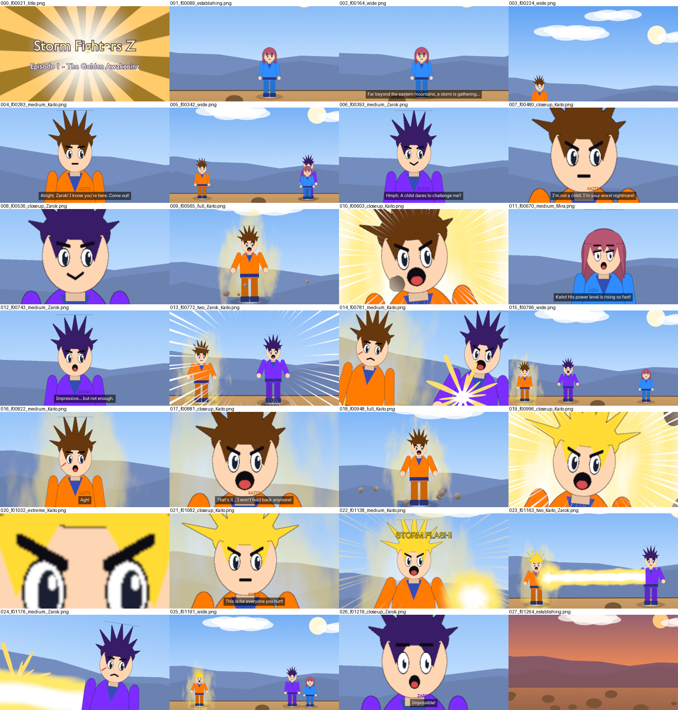

# Anime Studio for Blender

Anime Studio is a Blender add-on that turns your **story script**, **character sheets** and **location images** into a staged, animated **2D anime episode**, rendered as a single MP4 file. The style is inspired by Dragon Ball Z, Beyblade and Pokémon.

You write the story. The add-on handles:

| Area | What it does |
|---|---|
| **Direction** | Picks anime-style shots for every line (wide, full, medium, close-up, extreme close-up, two-shot, low angle, dutch angle) and cuts between them. Adds camera push-ins, snap zooms, pans and camera shake. |
| **Acting** | Moves characters on and off stage, sets expressions, animates mouth flaps while talking, adds blinks and idle breathing, turns characters to face each other, knocks them back when hit. |
| **Fights** | Power-ups (aura, burst background, flying rocks, speed lines), transformations, energy beams with charge-up and attack-name call-outs, dashes and punches with impact stars, clashes, explosions, creature summons, spinning battle tops. |
| **Editing** | Title card, wipe transitions between scenes, subtitles with coloured speaker names, voices, sound effects, music, and a "To be continued…" card with a next-episode line. |



If you have no art yet, it draws stand-in characters (spiky-haired fighters, long-haired heroines, round creatures, battle tops) and painted landscapes. That way you can write and preview the whole episode first, then drop in your real art later.

## What it is (and isn't)

It produces **limited animation**, the way TV anime handles most scenes: characters talk, react and change expressions, and camera work and effects carry the drama. It does **not** draw new poses or full fluid animation. That still needs an animator. Every shot is ordinary Blender data (cameras, image planes, keyframes, a Video Sequencer edit), so you can open any scene and refine it by hand.

## Install (Blender 4.2 or newer)

1. Run `python tools/build_zip.py`. This creates `dist/anime_studio.zip`. You can also zip the `anime_studio` folder yourself.
2. In Blender: **Edit › Preferences › Add-ons › (drop-down arrow) › Install from Disk…** and pick the zip.
3. Enable **Anime Studio**. A new **Anime** tab appears in the 3D Viewport sidebar (press **N**).

## Quick start

1. **Anime tab › Create Project Template.** Pick an empty folder. You get an example script (`episode_01.txt`) and the folders `characters/ locations/ voices/ sfx/ music/`.
2. **Check Script.** Shows characters, scenes, episode length and any problems. The full report goes to the Text Editor as *Anime Studio Report*.
3. **Build Episode.** Creates every scene and the episode edit, and switches to it. Scrub the timeline to watch.
4. **Render Episode.** Writes the MP4 to the **Output** path (default `//anime_episode.mp4`).

Tips:
- Set **Resolution %** to 25–50 for fast previews.
- Use **EEVEE** for speed. Use **Cycles** if your computer has no capable GPU.
- **Hype** overrides how dramatic the direction is: calm, normal or max hype.

## Your project folder

```
my_show/
  episode_01.txt            the script
  characters/
    kaito/                  one folder per character (named in the script)
      neutral.png           required: transparent PNG, full body, feet at the bottom
      angry.png happy.png sad.png surprised.png shout.png hurt.png smirk.png
      neutral_talk.png      mouth open, for talking (also angry_talk.png, ...)
      neutral_blink.png     eyes closed, for blinking
      super_neutral.png     a transformation form called "super" (super_angry.png, ...)
  locations/
    canyon.png              wide (16:9) background painting
  voices/   S01_001.wav     recorded voice for scene 1, dialogue line 1 (optional)
  sfx/      hit.wav beam.wav powerup.wav whoosh.wav explosion.wav clash.wav spin.wav
            summon.wav charge.wav land.wav zoom.wav   (optional; used automatically)
  music/    battle.mp3      (optional; MUSIC: line in a scene)
```

**Character art tips**
- Use transparent PNGs, cropped close to the character, with feet at the bottom edge.
- Every image of one character should have the same size and framing, so swapping expressions doesn't make the character jump.
- Only `neutral.png` is required. Missing expressions fall back to neutral. Missing talk images make the head bob while talking instead.
- Images with a plain white or green background work too: add `key: white` (or `key: #00ff00`) to the character.
- One **character sheet** image also works: `sheet: kaito_sheet.png`, `grid: 4x2`, `cells: neutral, neutral_talk, angry, angry_talk, happy, sad, surprised, hurt`. Cells are read left to right, top to bottom.

## Script format

```text
TITLE: Storm Fighters Z
EPISODE: Episode 1 - The Golden Awakening
STYLE: hype                 # calm | normal | hype
NEXT: Next time: Zarok's true power!
VOICES: off                 # on = computer text-to-speech for lines without recordings

CHARACTER: Kaito
  folder: characters/kaito
  color: #ff7a00            # subtitle name colour and default aura colour
  aura: gold
  height: 3.4               # relative size on screen
  faces: front              # which way the art looks: front | left | right (auto-mirrored)
  face: 0.88                # eye line as fraction of height, for close-up framing (optional)
  voice: male               # male | female (text-to-speech and stand-in art)
  kind: fighter             # fighter | creature | object (battle tops spin in place)

LOCATION: Rocky Canyon
  image: locations/canyon.png
  ground: 0.22              # how far up the image characters stand (0-1)

SCENE: Rocky Canyon - DAY   # DAY | NIGHT | SUNSET  (INT./EXT. headings work too)
MUSIC: music/tension.mp3
NARRATOR: Far beyond the eastern mountains...
Kaito lands from the sky.
KAITO (angry): Come out, Zarok!
[POWERUP Kaito]
[BEAM Kaito Zarok name="Storm Flash!"]
```

**Dialogue:** `NAME: line` or `NAME (expression): line`. Expressions: neutral, happy, angry, shout, sad, surprised, hurt, smirk. Words like *smiling*, *furious*, *yelling* and *shocked* are understood too. A screenplay layout also works: the name alone in capitals, then the lines. Add `{voice: voices/my_take.wav}` to a line to use a specific recording.

**Plain action lines** are acted out automatically when they describe something the add-on knows:
*"Kaito powers up"*, *"Zarok punches Kaito"*, *"Mira fires an energy blast at Zarok"*, *"Kaito transforms into super form"*, *"Mira throws a capsule"*, *"Ryo lands from the sky"*, *"Zarok flies away"*, *"Mira smiles"*, *"the ground shakes"*. Anything else becomes a short hold on the characters it mentions.

**Commands** (in square brackets; durations like `2s` and options like `color=red` are optional):

| Command | Effect |
|---|---|
| `[ENTER Kai left]` `[ENTER Kai from=top]` | Walk or fly in (to a slot: farleft, left, centerleft, center, centerright, right, farright) |
| `[EXIT Kai right]` `[EXIT Kai to=top]` | Leave the stage |
| `[MOVE Kai center]` `[PLACE Kai left]` | Walk to a slot / start the scene there |
| `[FACE Kai angry]` | Change expression (with a close-up) |
| `[POWERUP Kai color=gold 3s]` | Aura, burst background, rocks, shake, scream |
| `[TRANSFORM Kai super]` | Power-up with a flash, then switch to the `super_*` art |
| `[CALM Kai]` | Aura off |
| `[BEAM Kai Ryo name="Storm Flash!"]` | Charge, call-out caption, beam, impact |
| `[DASH Kai Ryo]` (`ATTACK`, `PUNCH`, `KICK`) | Rush in, hit, knock back |
| `[HIT Ryo]` | Impact on a character |
| `[CLASH Kai Ryo]` | Both rush in, repeated impacts, recoil |
| `[SPIN Blaze 3s]` (`LAUNCH`, `LET IT RIP`) | Spin (battle tops spin flat, fighters twirl) |
| `[SUMMON Mira Voltix]` | Flash of light, creature appears |
| `[EXPLOSION]` `[SHAKE 1s]` `[FLASH]` `[SPEEDLINES 1s]` | Screen effects |
| `[ZOOM Kai]` | Snap zoom to an extreme close-up |
| `[SHOT closeup Kai low]` | Force the framing of the next line (wide, full, medium, closeup, extreme, two; add `low` or `dutch`) |
| `[WAIT 2s]` `[CAPTION "Meanwhile..."]` `[SFX sfx/roar.wav]` | Pause, on-screen text, sound |

Comments start with `#` (on their own line, or after a space).

## Voices

Recorded voices give the best result: name them `voices/S01_001.wav`, `S01_002.wav`, … (scene number, dialogue line number within that scene). Each line's timing then follows its recording. Without recordings, tick **Placeholder Voices** (or set `VOICES: on`) to generate voices with the text-to-speech already on your computer: Windows Speech, macOS `say`, or `espeak-ng` on Linux. Otherwise the episode uses subtitles only.

## Command line

```
blender -b -P anime_studio/cli.py -- --script my_show/episode_01.txt --render
```

Options: `--engine EEVEE|CYCLES|WORKBENCH`, `--quality 50`, `--hype 2`, `--tts`, `--save built.blend`, `--stills preview_folder` (one PNG per shot for quick review).

## What gets built

- **AS EPISODE – title**: the edit (Video Sequencer). Render this scene.
- **AS S01 …, AS S02 …**: one 3D scene per script scene. The camera cuts are timeline markers, characters are empties with image planes, and effects are animated planes. Edit anything you like.
- **AS Title Card / AS End Card**: the opening and closing cards.

**Build Episode** replaces only what it generated earlier, so keep hand edits in a copy of the `.blend` if you plan to rebuild.

## Development

- `python -m unittest discover tests`: parser and director tests (no Blender needed).
- `blender -b -P anime_studio/cli.py -- --script anime_studio/templates/example_script.txt --stills /tmp/stills --quality 40`: build the example and render one still per shot.
